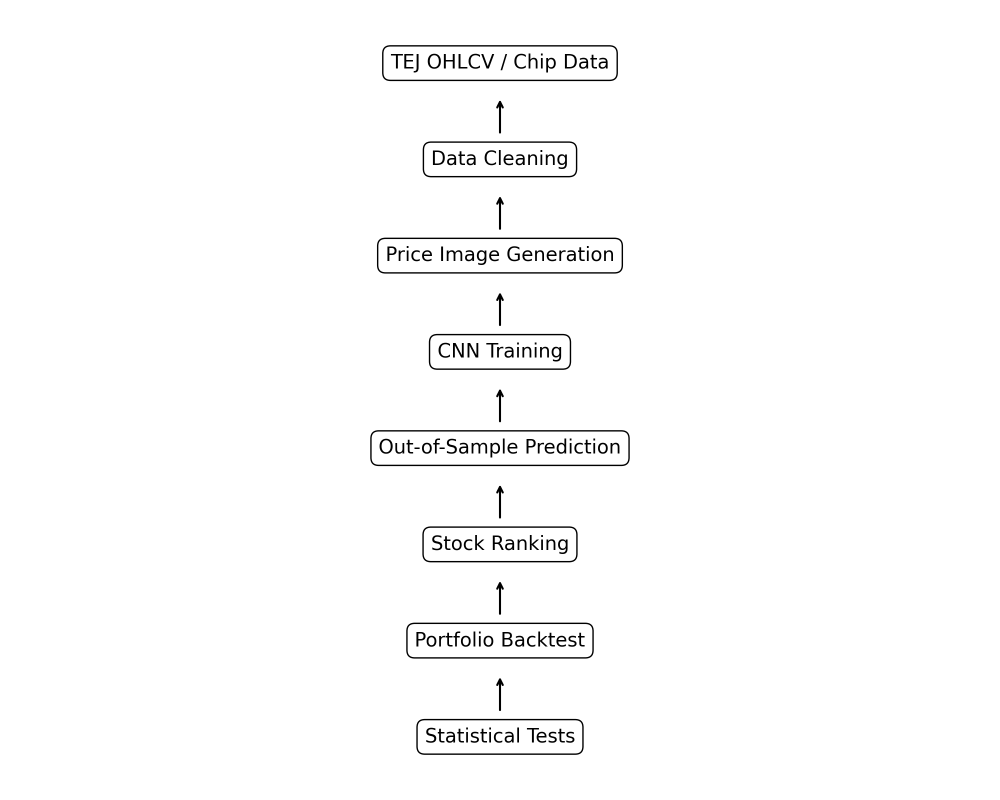

# 基於卷積神經網路之臺股雙通道價格圖像投資策略

**A CNN-Based Dual-Channel Price-Image Investment Strategy for Taiwan Stocks**

中原大學資訊管理學系碩士論文（2026 年 7 月）。研究使用臺灣上市櫃股票歷史價量資料，將價格資訊轉換為圖像，透過卷積神經網路（CNN）進行未來報酬方向預測與同日股票排序。本頁以**最終提交的碩士論文**為準；儲存庫內另保留早期探索實驗與公開展示用程式，必須分開解讀。

> **重要：** 本儲存庫不是完整、可一鍵重現正式論文所有數值的原始研究環境。部分程式為公開展示用精簡版本，訓練資料受臺灣經濟新報（TEJ）授權限制不公開。下列研究數值為論文中記錄的歷史樣本外實證結果，並非真實投資績效。

## 研究重點

1. **臺股價格圖像基準**：使用開高低收（OHLC）、移動平均線與成交量建立價格圖像，交叉比較 5、20、60 日觀察窗及 5、20、60 日預測期，合計九組設定。
2. **成對排序學習（RankNet）**：在價格圖像 CNN 的基礎上，將訓練目標由個股報酬方向分類延伸為「同一交易日兩檔股票未來表現的相對順序」。
3. **獨立日報酬通道**：完整保留原價格圖像為第一通道；第二通道僅加入逐日對齊的單日報酬率柱狀圖，檢驗分離表徵是否能提供增量資訊。

## 資料與實驗設計

| 項目 | 最終論文設定 |
|---|---|
| 資料來源 | 臺灣經濟新報（TEJ），臺灣上市櫃股票日頻價量 |
| 研究期間 | 2000–2025 年 |
| 股票數、股票－日期觀測 | 1,898 檔、約 692 萬筆（論文表 3-2） |
| 估計期間 | 2000–2007 年，期間內訓練／驗證分配為 70%／30% |
| 樣本外測試 | 2008–2025 年，未參與模型估計 |
| 時間尺度 | 觀察窗 W = 5／20／60 日；預測期 H = 5／20／60 日 |
| 核心受控比較 | W20H5（過去 20 日預測未來 5 日） |
| 輸入 | 單通道價格圖像；或價格圖像＋每日單日報酬率雙通道 |
| 評估 | AUC、準確率、十分位投資組合、年化報酬、夏普比率、最大回撤 |

核心比較使用相同的資料、估計與評估邏輯。W20H5 是由九組結果比較後選出的**代表性設定**，不是事前指定的全市場最優參數。

## 最終論文主要成果

### 1. 九組時間尺度與成對排序（論文表 4-1、4-2）

- W20H5 價格圖像分類基準：D10−D1 年化報酬差 **49.39%**。
- RankNet 在相同 W20H5 方向的三次獨立訓練（隨機種子 42／43／44）：平均 D10−D1 年化報酬差 **59.77%**。
- 兩者差 **10.38 個百分點**，但尚未完成逐次完全配對與正式統計檢定，僅作描述性比較，不作顯著性或因果宣稱。

### 2. 獨立日報酬通道核心受控比較（論文表 4-3）

以下均為 **W20H5、三次獨立訓練彙整平均**；不要與上一節的 49.39% 單批次基準混用。

| 指標 | 價格圖像分類基準 | 獨立日報酬雙通道 |
|---|---:|---:|
| AUC | 0.5435 | **0.5527** |
| 準確率 | 0.5305 | **0.5364** |
| D10 年化報酬 | 42.61% | **50.39%** |
| D10 夏普比率 | 2.05 | **2.46** |
| D10−D1 年化報酬差 | 57.90% | **74.08%** |
| D10−D1 夏普比率 | 5.65 | **6.34** |
| D10−D1 最大回撤 | −7.96% | **−6.36%** |

在這組受控比較中，D10−D1 年化報酬差增加 **16.18 個百分點**。此為特定研究設定下的歷史樣本外結果，**尚未完成正式統計顯著性檢定**；不代表策略可以實際達成相同報酬。

### 3. 研究邊界

其他觀察窗與預測期下，雙通道模型的分類指標與投資組合績效不一定同方向改善。新增通道的效益具有時間尺度限制，不宜推廣為所有設定皆優。

## 方法示意

- 價格圖像：以每日三個水平像素呈現 OHLC，搭配移動平均線和成交量；20 日觀察窗的基準圖像為 **1 × 64 × 60**。
- 新增日報酬通道後：兩張灰階圖像沿通道維度組合為 **2 × 64 × 60**；第二通道的每日漲跌幅在 0% 中線上下呈現，並依相同交易日水平對齊。
- 使用 CNN 輸出分類分數；另於 RankNet 路徑比較同日股票的相對名次。
- 每個形成日依模型分數排序成 D1～D10，檢視高低分組與風險調整後指標。

## 程式碼與結果的適用範圍

本儲存庫包含 `src/`、`configs/`、`docs/`、`reports/`、`outputs_sample/` 等資料夾；**這些內容不完全對應最終論文的核心版本**：

- `src/train.py` 目前是公開流程示意入口，未實作完整訓練與輸出程序。
- `src/model.py` 是簡化 CNN 示範模型，不能視為論文表 3-3 中完整架構的精確重現。
- `configs/chen_dual_channel.yaml`、部分籌碼通道設定、`reports/main_results.csv` 以及 `reports/walk_forward_*` 是其他批次或歷史探索性實驗；其期間、切分、資訊配置及數據**不可直接與上方正式論文成果混合比較**。
- 公開 `src/backtest.py` 是基本十分位報酬計算示範，不等於論文完整的非重疊投資組合、交易摩擦及穩健性驗證流程。
- 目前沒有公開可核對正式論文所有實驗的 config、完整訓練程式、原始預測或研究資料。若未取得相同資料與私有環境，無法僅依本儲存庫一鍵重現論文表格。

更詳細的範圍說明請見 [正式論文與既有儲存庫差異](docs/thesis_alignment.md)；既有歷史實驗記錄保留在 `reports/`，並非本 README 所列正式論文主結果。

## 研究限制與使用聲明

- 估計期間內訓練／驗證分配仍有時間相依性風險；W20H5 屬資料驅動選出的代表設定。
- RankNet 與分類基準尚未完成逐次完全配對；正式多重假設與統計顯著性檢定未完整執行。
- 主要投資組合結果未完整納入手續費、交易稅、價差、滑價、借券成本、市場衝擊、流動性及容量限制。
- D10−D1 包含低分組放空，主要用來診斷排序能力，**不能視為可直接實現的交易報酬**。
- TEJ 資料受授權約束，未於公開儲存庫上傳原始授權資料。

**論文名稱**：基於卷積神經網路之臺股雙通道價格圖像投資策略（2026）  
**英文名稱**：A CNN-Based Dual-Channel Price-Image Investment Strategy for Taiwan Stocks
