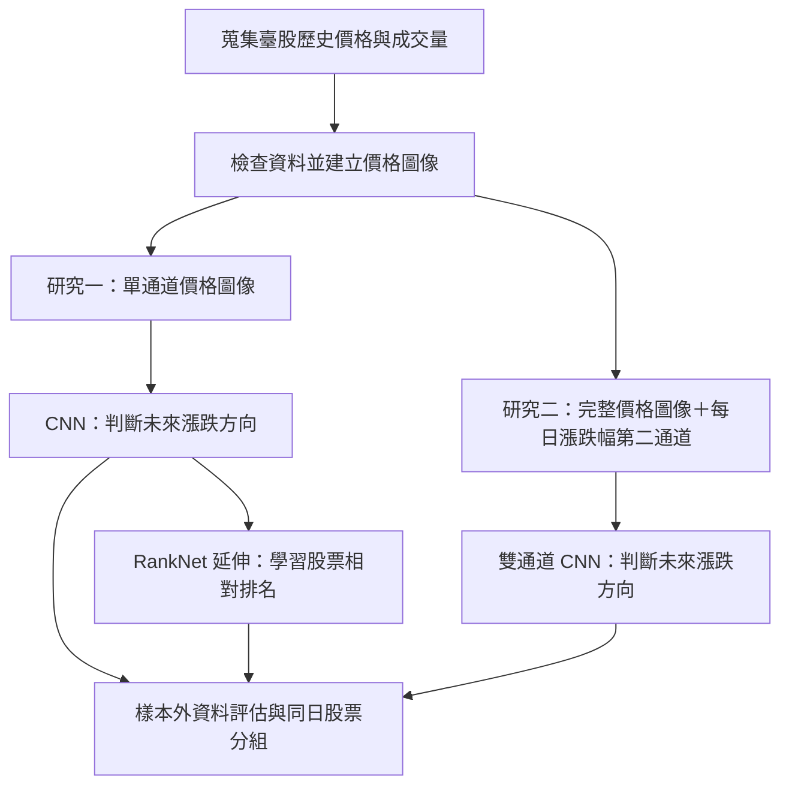
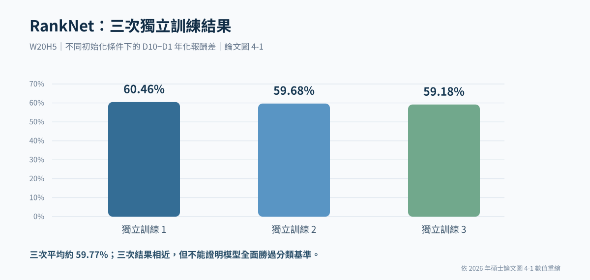
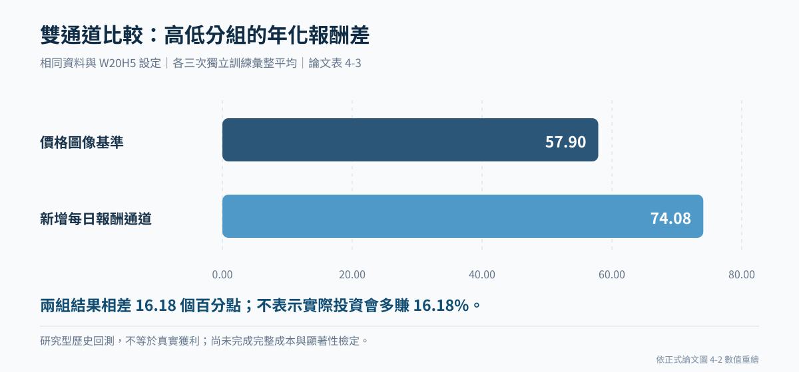

# 基於卷積神經網路之臺股雙通道價格圖像投資策略

**A CNN-Based Dual-Channel Price-Image Investment Strategy for Taiwan Stocks**

中原大學資訊管理學系｜2026 年碩士論文  
研究主題：股票價格圖像、深度學習、股票排序與歷史資料驗證

## 這個研究在做什麼？

看股票時，我們通常會觀察過去的價格走勢與成交量，嘗試判斷未來哪些股票可能表現較好。**但這些走勢包含大量資訊，單靠幾條事先設定的技術指標，不一定能完整描述其中的變化。**

我的研究嘗試換一種方式：**把一段時間的股價與成交量轉成圖片，讓電腦從圖像中學習特徵，再用模型分數比較同一天不同股票未來的相對表現。**

這項研究的目標是**探索選股訊號與模型排序能力**，而不是預測股票一定會漲、直接推薦買賣，或建立能自動下單的交易系統。

## 為什麼要把數值資料轉成圖片？不能直接用 LSTM 嗎？

**可以，而且這是合理的替代方案。** 股票本來就是依時間排列的數值資料，長短期記憶網路（LSTM，一種專門處理時間序列的神經網路）、一維卷積神經網路等方法，都能直接分析價格和成交量。**本研究沒有證明圖像模型優於 LSTM，也沒有把 LSTM 納入正式的同條件對照實驗。**

選擇價格圖像，是因為我想研究**不同的資料呈現方式，是否能讓模型學到不同的價格特徵**：

1. **從數字序列變成相對形狀：** 把每天的開高低收、均線與成交量依時間畫在固定圖像上，模型就能從相鄰日期的線條位置、價格區間和走勢形狀找出可能有用的特徵。
2. **利用 CNN 擅長的局部圖像辨識：** 模型可以學習短期形狀與相鄰位置之間的關係，不必先由研究者列出所有可能的技術型態或訂好固定規則。
3. **讓不同價位的股票更容易比較形狀：** 繪圖時依各自觀察窗的價格範圍進行縮放，使不同名目股價的股票以相同尺寸呈現；模型著重的是相對變化，而非絕對股價。

**但這不是免費的優勢。** 製作圖片會增加資料處理步驟與運算負擔，像素化及縮放也可能捨棄部分數值精度；如果採用適當的數值標準化與模型設計，LSTM 或其他時間序列方法也可能做得更好。**圖像並沒有憑空創造原始資料沒有的市場資訊，而是改變模型看到資訊的方式。**

因此，這篇論文真正回答的是：「**在價格圖像 CNN 的研究框架內，改變學習目標或新增每日報酬通道，是否有助於樣本外排序？**」而不是「圖像模型一定勝過所有數值模型」。若要回答後者，還需要使用相同資料期間、切分方式、預測目標及投資組合規則，另外與 LSTM、一維 CNN 等模型進行公平對照。

**研究依據：** [Jiang、Kelly 與 Xiu（2023），〈(Re-)Imag(in)ing Price Trends〉，《金融學期刊》](https://economics.yale.edu/research/re-imagining-price-trends)。原研究對圖像與時間序列表示方法的優缺點有專節討論，也指出不能排除妥善設計的 LSTM 優於圖像 CNN 的可能性。本頁的研究範圍與結果則仍以[本人的正式碩士論文方法](docs/methodology.md)為準。

## 先認識幾個關鍵名詞

第一次接觸這類研究，可以先理解以下名詞，再往下閱讀實驗方法與結果。

| 名詞 | 白話解釋 | 在本研究中的用途 |
|---|---|---|
| **價量資料（OHLCV）** | 一檔股票每天的開盤價、最高價、最低價、收盤價與成交量 | 用來描述歷史股價走勢 |
| **價格圖像** | 把過去一段時間的價量資料，依固定規則畫成黑白圖片 | 讓模型從圖像學習價格形狀與變化 |
| **卷積神經網路（CNN）** | 一種擅長從圖片辨認局部特徵的深度學習模型 | 分析價量圖像，產生股票預測分數 |
| **長短期記憶網路（LSTM）** | 一種可直接學習時間序列數值變化的神經網路 | 本論文未實作為正式對照模型；它是合理的替代研究方向 |
| **雙通道** | 把兩類資訊分開表示，再一起提供給同一個模型 | 第一通道保留完整價量圖像；第二通道加入每天的漲跌幅圖 |
| **成對排序學習（RankNet）** | 讓模型比較「同一天兩檔股票，哪檔未來表現相對較好」 | 使模型學習股票間的相對排序，而不只是個股漲跌方向 |
| **樣本外測試** | 使用沒有參與模型估計的後續資料檢驗表現 | 檢查模型對未見過的歷史期間是否仍有辨識能力 |
| **W20H5** | W 是使用過去幾天，H 是要預測未來幾天 | 代表「看過去 20 個交易日，預測未來 5 個交易日」 |
| **D1、D10、D10−D1** | 將同一天的股票依模型分數分成 10 組；D1 是最低分組，D10 是最高分組 | 比較高低分組的歷史報酬差距，觀察模型是否有排序能力 |

> **如何看待 D10−D1？** 例如「D10−D1 年化報酬差為 74.08%」，是把最高分組與最低分組的歷史報酬差距年化後得到的研究指標，**不是買入某檔股票能賺 74.08%，也不是模型的預測準確率**。它涉及假設放空低分組，因此更不能直接當作實際交易獲利。

## 我做了哪些研究？

研究分成兩條路徑，都是從「將股票價量資料變成圖片，再使用 CNN 分析」出發；**這是兩種不同改良方向，不代表把 RankNet 與雙通道直接合併成同一個主模型。**

### 研究一：改變模型學習的問題

原本的分類模型主要學習「這檔股票未來會不會上漲」。但實際選股常需要回答的是：「同一天有很多股票，哪一檔未來相對較好？」

因此我在價格圖像模型上加入 **RankNet 成對排序學習**，讓模型透過比較股票之間的未來報酬，學習它們的相對順序。

### 研究二：改變資料呈現的方式

原本一張價格圖像已包含開盤、最高、最低、收盤、移動平均線與成交量。我保留這些資訊，再把**每天的單日漲跌幅**另外畫成第二個圖像通道。

這樣的目的，是檢查：**當漲跌幅被獨立呈現，而不是只隱含在價格變化中，模型能否獲得額外有用的資訊？**

| 輸入 | 包含什麼 |
|---|---|
| 第一通道：完整價格圖像 | 每日開高低收、移動平均線、成交量 |
| 第二通道：每日報酬圖像 | 每天的單日漲跌幅，正值向上、負值向下，與第一通道日期對齊 |

兩張圖片一同輸入**同一個 CNN**。以過去 20 日的代表性設定為例，兩通道合併後的資料尺寸是 `2 × 64 × 60`（通道數 × 圖像高度 × 圖像寬度）。

## 研究流程



**兩個圖像通道實際上如何對齊？** 以下是依論文方法製作的概念示意，**使用合成資料，不是真實股票或論文正式輸入圖像**。


研究方法、正式模型架構及資料處理細節：[方法說明](docs/methodology.md)。

## 研究使用哪些資料？

| 項目 | 說明 |
|---|---|
| 股票市場 | 臺灣上市櫃股票 |
| 資料來源 | 臺灣經濟新報（TEJ）日頻價量資料 |
| 資料期間 | 2000–2025 年 |
| 資料規模 | 1,898 檔股票、約 692 萬筆股票－日期觀測 |
| 模型估計 | 2000–2007 年，其中 70%／30% 分配給訓練／驗證 |
| 樣本外評估 | 2008–2025 年，不參與模型參數估計 |
| 比較的時間設定 | 使用過去 5、20、60 日，分別預測未來 5、20、60 日，共 9 組 |

**為什麼要分開估計與測試？** 如果只用模型學習過的資料來評估，很難知道它是學到有用的規律，還是只記住過去的資料。樣本外測試可以提供另一個檢查角度，但仍不能完全排除過度擬合。

後續主要展示 **W20H5（過去 20 日、未來 5 日）**，這是比較九組設定後選出的代表性條件，**不是已證明最好的投資參數**。

## 研究結果

### 結果一：讓模型學習股票的相對排序

在 W20H5 設定下，論文記錄：

| 方法 | D10−D1 年化報酬差 |
|---|---:|
| 價格圖像分類基準（論文表 4-1） | 49.39% |
| RankNet 成對排序，三次訓練平均（論文表 4-2） | 59.77% |



*圖：依論文圖 4-1 的數字重繪；顯示三次訓練結果，並非與分類模型逐次配對的優劣檢定。*

這表示兩批研究結果在排序指標上有差異，**但它們並非逐次完全配對的實驗**，不能把差距解讀成已證明 RankNet 必然優於分類模型。

### 結果二：把每日漲跌幅獨立畫成第二通道

這是論文表 4-3 的**核心受控比較**：在共同的 W20H5 資料與評估設定下，比較原本的價格圖像模型和加入第二通道的模型；表內是三次獨立訓練的彙整平均。

先認識下表另外兩個指標：

- **AUC（區辨能力）：** 衡量模型把實際上漲樣本排在未上漲樣本之前的能力；約 0.5 代表接近隨機，數值越高通常表示方向區辨能力越好，但**不是報酬率**。
- **夏普比率（Sharpe ratio）：** 比較投資組合報酬與波動風險的指標；在相同計算方式下可用來輔助比較風險調整後的表現。
- **最大回撤：** 描述評估期間內，投資組合累積價值從先前高點下跌的最大幅度。




*圖：依論文圖 4-2、圖 4-3 數據重繪，兩圖均屬 W20H5 核心受控比較。圖表呈現差異，完整指標則保留在下方表格；數據不是實際交易獲利。*

| 指標 | 原本的價格圖像模型 | 加入每日報酬第二通道 |
|---|---:|---:|
| AUC | 0.5435 | 0.5527 |
| 分類準確率 | 53.05% | 53.64% |
| 最高分組（D10）年化報酬 | 42.61% | 50.39% |
| **高低分組（D10−D1）年化報酬差** | **57.90%** | **74.08%** |
| D10−D1 夏普比率 | 5.65 | 6.34 |
| D10−D1 最大回撤 | −7.96% | −6.36% |

**主要發現：** 在這組特定歷史實驗中，加入每日報酬通道後，高低分組的年化報酬差增加 **16.18 個百分點**。分類指標與部分風險指標也呈現較高或較佳的數值。

**不能從這個結果推論：** 第二通道在所有市場、所有時間尺度都一定更好，或實際投資可獲得上述報酬。完整統計顯著性檢定尚未完成。

> **讀表提醒：** 前一節基準的 49.39% 和本節基準的 57.90% **來自不同實驗批次與彙整方式**，不可混成一組直接比較。完整界線請看 [正式論文與歷史實驗對照](docs/thesis_alignment.md)。

## 程式碼可以看到什麼？

此儲存庫公開的是**部分程式示範及歷史研究紀錄**，而不是完整重現正式論文的訓練環境。

| 資料夾 | 內容 |
|---|---|
| [`src/`](src/) | 圖像生成、簡化 CNN 與基礎回測的公開示範程式 |
| [`docs/`](docs/) | 正式論文方法、資料與可重現性說明 |
| [`configs/`](configs/) | **早期探索性實驗設定**，不是最終論文的主模型設定 |
| [`reports/`](reports/) | **早期探索性實驗報表**及論文摘要；舊數據不可與正式主結果混用 |
| [`outputs_sample/`](outputs_sample/) | 示範圖片及歷史素材，並非正式論文完整雙通道輸入 |

### 執行簡化的價格圖像示例

安裝 Python 後，依序執行：

```bash
git clone https://github.com/wbk169/reimaging-tw-stock-cnn.git
cd reimaging-tw-stock-cnn
python -m pip install numpy matplotlib
python scripts/make_sample_image.py
```

執行後產生 `outputs_sample/sample_images/sample_001.png`。它使用**隨機合成的價格資料**，只示範 OHLC 價格線條，**尚未包含論文使用的均線、成交量或每日報酬第二通道**。

目前 `src/train.py` 僅為訓練流程入口示意，並不會完成正式論文的模型訓練。詳細參見 [程式使用及可重現性說明](docs/reproducibility.md)。

## 研究限制與資料聲明

- **歷史回測不是實際交易：** D10−D1 含低分組放空，尚未完整納入手續費、交易稅、價差、滑價、借券成本及流動性限制；模型訊號產生時間也與實際成交價格有差異。
- **研究仍有不確定性：** 估計期內的時間相依性、九組設定後選出的代表性條件、部分模型比較缺少逐次配對，以及未完成完整多重假設與正式統計檢定，均限制結果解讀。
- **原始資料不公開：** TEJ 行情資料涉及授權，本儲存庫沒有提供完整原始資料、全部模型權重或可逐次對應正式論文的完整訓練程式。
- **早期研究版本分開保存：** 既有籌碼配置與 walk-forward 實驗紀錄不等於正式論文主結果。

進一步了解：[資料說明](docs/data_description.md)｜[研究版本對照](docs/thesis_alignment.md)｜[研究限制](reports/limitations.md)。

## 論文資訊

王柏凱（2026）。《基於卷積神經網路之臺股雙通道價格圖像投資策略》。中原大學資訊管理學系碩士論文。  
英文題名：*A CNN-Based Dual-Channel Price-Image Investment Strategy for Taiwan Stocks.*

本儲存庫用途為研究介紹與部分技術展示，不構成投資建議。
