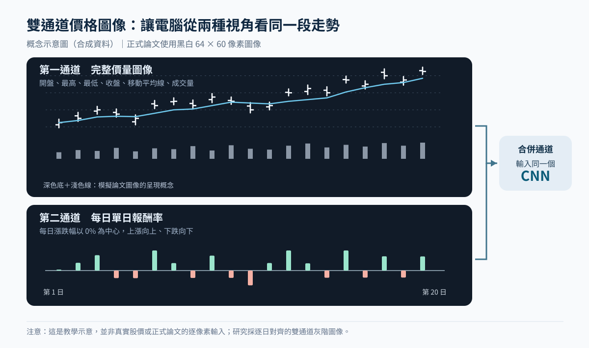

# 研究方法（最終碩士論文版本）

本文件依正式論文第 3 章、表 3-3 與第 4 章整理研究方法。公開 `src/` 為部分示範程式，**不能等同於下述完整正式實作**。

## 方法選擇：為何使用價格圖像，而非直接使用數值時間序列？

**研究動機，而非方法排名：** 原始資料是每天的開盤、最高、最低、收盤與成交量，當然也可以直接輸入長短期記憶網路（LSTM）、一維卷積神經網路或其他時間序列模型。本論文採用價格圖像，是沿用 Jiang、Kelly 與 Xiu（2023）的價量圖像研究路徑，檢驗幾何表徵與 CNN 的局部特徵學習能否為臺股樣本提供有用的排序分數；**正式論文沒有執行 LSTM 同條件對照，不能宣稱 CNN 或圖像表示全面優於數值模型。**

### 這種表示法可能帶來的研究價值

- **局部空間關係：** 價格圖像將相鄰日期、OHLC 位置、移動平均線及成交量安排在固定空間位置，讓二維卷積核學習局部形狀。
- **相對尺度：** 每張圖像依各自觀察窗內的價位範圍縮放，讓不同股票的相對價量形態便於共同處理。
- **以圖像特徵取代部分手工特徵設計：** 模型不需要先被告知每一種技術型態的判斷規則，但也不能因此推論一定不受人為設計選擇影響。

### 代價與尚未驗證的部分

- **轉換不是新增市場資訊：** 圖像是原始數值的一種表徵；像素離散化與縮放可能損失精細數值資訊。
- **額外工程與計算成本：** 繪圖、存取圖片及二維卷積的負擔，需與直接處理標準化數值的模型比較，不能預設哪種方法更省資源。
- **需要公平的模型比較：** 若要主張圖像 CNN 優於 LSTM，至少要在同股票池、樣本切分、預測期間、輸入可得資訊、調參預算及一致的投資組合評估條件下進行比較，並報告不確定性；此項研究**並未完成**。

本論文正式研究範圍是價格圖像分類基準、RankNet 成對排序，以及「完整價格圖像＋每日單日報酬率」的受控輸入表徵比較。這兩條路徑**不等於**直接比較 LSTM 與 CNN，也不等於把 RankNet 與雙通道直接合併成同一主模型。

參考文獻：Jiang、Kelly 與 Xiu（2023），[(Re-)Imag(in)ing Price Trends](https://economics.yale.edu/research/re-imagining-price-trends)，尤其「影像表示與時間序列表示」一節，作者亦明確承認不能排除妥善設計的 LSTM 在其他比較下取得更好結果的可能性。

## 方法圖解：兩個通道如何一起輸入 CNN？

以下示意圖依正式論文第 3.4 節的兩通道設計製作。**價格與每日報酬必須以相同交易日期對齊**，但示意資料為人工合成，不是 TEJ 原始數據或論文的原始模型圖片。

## 1. 研究問題

- **RQ1：** 價格圖像的觀察／預測期間及分類或成對排序學習，如何影響同日股票排序？
- **RQ2：** 在保留完整價格圖像的情況下，新增每日單日報酬率的獨立通道，是否帶來額外資訊？

## 2. 資料與評估切分

使用 2000–2025 年臺灣上市櫃股票日資料。2000–2007 年為估計期間（70% 訓練／30% 驗證），2008–2025 年保留為樣本外評估。九組 W／H 取 `W = {5,20,60}`、`H = {5,20,60}` 交叉組合；W20H5 是比較後選出的代表性設定。

資料索引只讓截至形成日 `t` 的資訊進入圖像。未來 H 日報酬只做標籤與評估。低價股、低成交金額等可交易性條件**沒有加入核心樣本門檻**。

## 3. 價格圖像與雙通道設計

- **基準通道：** 每日三個水平像素呈現 OHLC；另含移動平均線與成交量，20 日圖片尺寸為 `1×64×60`。
- **第二通道：** 每日單日報酬率，以 0% 為中線、正負報酬柱向上或向下，與基準通道交易日完全對齊；主要顯示裁切為 ±10%，**只限制繪圖高度、不更動原始報酬**。
- **雙通道張量：** `2×64×60`，兩個通道共同輸入同一個 CNN。正式論文未將成交量移至第二通道。

## 4. 模型與兩條改良路徑

W20 分類模型的正式架構（論文表 3-3）為三個卷積區塊，輸出通道分別為 64、128、256，卷積核 `5×3`，搭配批次正規化、LeakyReLU、`2×1` 最大池化，最後接 Dropout 0.5 與二分類輸出。

- **路徑 A：** 價格圖像分類基準與 RankNet。RankNet 將同一形成日股票配對，以未來報酬相對高低作為排序目標，使用成對損失；三次獨立訓練種子為 42、43、44。
- **路徑 B：** 在相同分類學習與 CNN 主體下，比較「完整價格圖像」和「完整價格圖像＋每日單日報酬通道」，分別進行三次獨立訓練的核心受控比較。

## 5. 評估與投資組合

使用 AUC、準確率、分組報酬、夏普比率及最大回撤評估。各形成日依模型分數由低至高分成 D1～D10；`D10−D1` 用於衡量高低分組的歷史相對排序差距，**不代表可直接完成的實盤多空交易**。

核心報酬未完整扣除成本、稅費、價差、滑價、借券成本及容量限制；亦未完成完整統計顯著性與多重假設檢定。不能將 `src/backtest.py` 或 `src/stats_test.py` 當作已覆蓋上述所有評估的證據。

正式數字見 [README](../README.md)；版本差異見 [研究版本對照](thesis_alignment.md)。