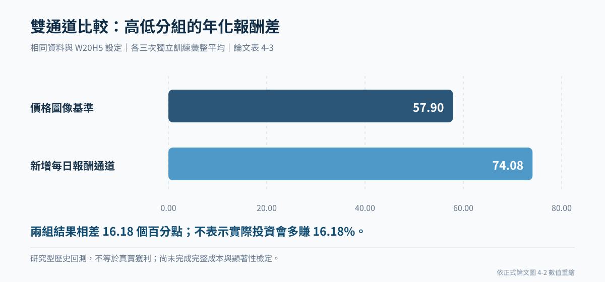
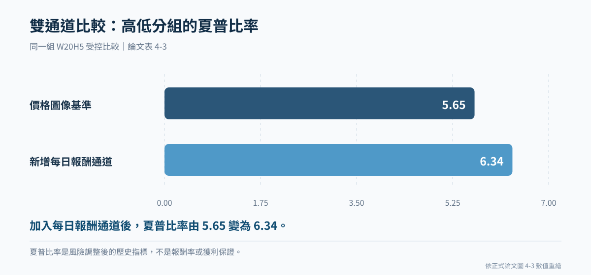

# 正式碩士論文與公開儲存庫的範圍對照

此文件說明本儲存庫歷史探索性實驗與 **2026 年 7 月正式提交之碩士論文**的差異，避免讀者將不同資料期間、模型配置或回測批次混合比較。

## 正式論文

- 題名：基於卷積神經網路之臺股雙通道價格圖像投資策略
- 英文：A CNN-Based Dual-Channel Price-Image Investment Strategy for Taiwan Stocks
- 樣本：臺灣上市櫃股票 2000–2025 年日頻資料。
- 核心固定切分：2000–2007 年模型估計（其間 70% 訓練、30% 驗證）；2008–2025 年樣本外評估。
- 研究路徑一：價格圖像分類基準九組 W／H 設定，延伸 RankNet 成對排序。
- 研究路徑二：完整保留 OHLC、移動平均線、成交量的價格圖像，再增加**獨立每日單日報酬率**第二通道。
- 主受控比較：W20H5，單通道基準與獨立日報酬通道在共同設定下各進行三次獨立訓練。

## 重要數字與比較口徑

| 論文出處 | 比較內容 | D10−D1 年化報酬差 |
|---|---|---:|
| 表 4-1 | 九組 W／H 中的 W20H5 單批次分類基準 | 49.39% |
| 表 4-2 | RankNet 三次獨立訓練平均 | 59.77% |
| 表 4-3 | 核心受控比較：分類基準，三次平均 | 57.90% |
| 表 4-3 | 核心受控比較：獨立日報酬通道，三次平均 | 74.08% |

**49.39% 與 57.90% 是不同實驗彙整口徑，不能任意互換。** 另在論文附錄三的報酬率裁切敏感度矩陣中，W20H5、裁切參數 0.10 的 D10−D1 年化報酬差為 **74.38%**；論文第 4.4 節已註明該數字與表 4-3 的 **74.08%** 來自不同彙整批次，不能混為同一組受控比較。 RankNet 與其對照分類模型尚未完成完全逐次配對，未做正式統計顯著性檢定。上述數字為歷史樣本外回測，主要報酬未完整扣除所有交易摩擦。

### 圖像化呈現（與表 4-3 直接對應）

這些圖只重繪正式論文表 4-3／圖 4-2、4-3 的兩模型受控比較，不將表 4-1 與表 4-3 的不同基準數字混在同一張圖上。

## 此儲存庫中的非正式主結果

- `reports/main_results.csv`：舊版單／雙／三／四通道與籌碼實驗，結果不是正式論文表 4-3 的來源。
- `reports/walk_forward_experiment_log.md`、`reports/walk_forward_results_*.csv`：歷史擴張視窗實驗記錄，測試期間與模型設定不同；不能用來取代正式論文的固定切分主結果。最終論文也有描述擴張視窗補充檢查，但不能認定既有公開記錄就是其完整對應輸出。
- `configs/chen_dual_channel.yaml`：為另一種通道資訊配置；不是正式論文採用的「完整價格圖像＋獨立每日單日報酬」主模型設定。
- `configs/chip_3ch.yaml`：籌碼資料相關探索設定，未列入最終論文主線。
- `reports/statistical_tests.csv`：歷史檢定檔；正式論文並未宣稱已完成完整的多重假設與正式顯著性檢定，不能將舊檔結果移植成正式研究結論。

## 公開程式的限制

- `src/train.py` 只列示環境與實驗設定流程，沒有完整的資料集、模型訓練、驗證與預測輸出。
- `src/model.py` 是簡化的公開 CNN 示範，卷積核等細節與正式論文 W20 架構不同。
- `src/backtest.py` 提供基本十分位報酬計算，未實現正式論文全部投資組合評估和交易摩擦條件。
- 未公開可完全對應最終論文的原始 TEJ 授權資料、完整研究程式、所有訓練輸出及模型預測紀錄。

因此本 repo 目前適合用來**理解研究方向、檢視部分程式與探索性紀錄**，不應宣稱已完整重現正式論文所有結果。

## 下一步補齊順序

1. 整理與正式論文一致的資料處理、雙通道影像生成、CNN／RankNet 訓練與評估程式。
2. 將正式論文的實驗設定、隨機種子、輸出檔案與指標彙整建立一一對應的可追溯清單。
3. 補充自動化測試與可執行環境說明；公開前再次排除授權原始資料、憑證或個人敏感資訊。

本對照依正式提交論文之摘要、研究方法、第四章及附錄編寫；未捏造缺少的實驗檔案或統計檢定。
