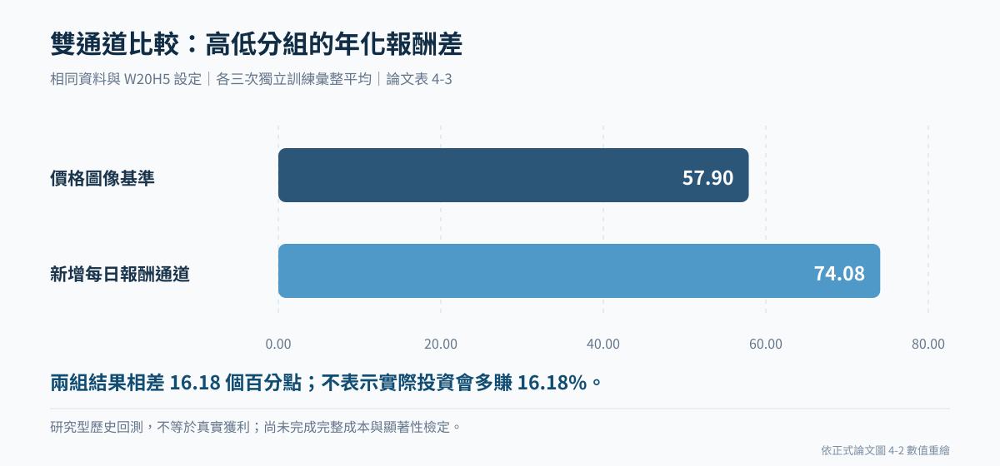
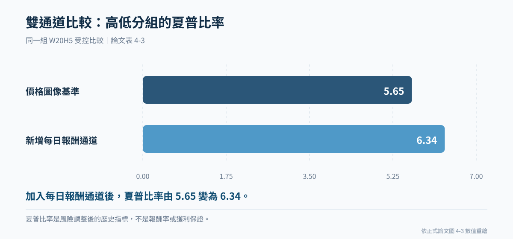

# 正式碩士論文｜研究摘要

> **版本說明：** 本頁以 2026 年 7 月提交之最終論文為準。此資料夾中的部分 CSV 與 walk-forward 紀錄是另一批歷史探索實驗；請先閱讀 [實驗檔案分類](README.md)。

## 研究問題

1. 臺股價格圖像 CNN 的觀察期間、預測期間與學習目標，是否影響同日股票的相對排序？
2. 在不移除原有 OHLC、移動平均線與成交量資訊的前提下，加入**獨立每日單日報酬率通道**，是否提供額外的可學習資訊？

## 主要方法

- 使用 2000–2025 年臺灣上市櫃股票日資料，核心固定切分為 2000–2007 年估計、2008–2025 年樣本外評估。
- 比較 5／20／60 日觀察窗 × 5／20／60 日預測期，共九組價格圖像分類基準。
- 在 W20H5 進行 RankNet 成對排序延伸，以及價格圖像 CNN 的每日報酬獨立通道比較。
- 依預測分數進行同日十分位股票分組（D1～D10），同時檢查分類指標和投資組合歷史績效。

## 正式論文成果摘要

| 實驗出處 | 指標 | 結果 |
|---|---|---:|
| 論文表 4-1 | W20H5 價格圖像分類基準，D10−D1 年化報酬差 | 49.39% |
| 論文表 4-2 | RankNet 三次獨立訓練平均，D10−D1 年化報酬差 | 59.77% |
| 論文表 4-3 | 核心受控比較之基準模型，D10−D1 年化報酬差 | 57.90% |
| 論文表 4-3 | 核心受控比較之獨立日報酬雙通道，D10−D1 年化報酬差 | 74.08% |

**注意：** 表 4-1 的 49.39% 和表 4-3 的 57.90% 使用不同彙整批次，不得視為同一模型完全配對的結果。表 4-3 的兩組結果相差 16.18 個百分點，但尚無正式顯著性檢定證明具有統計顯著性。

### 核心實驗的圖像化比較

*圖表依正式論文圖 4-2、4-3 的數值重繪。上述 D10−D1 為歷史排序回測指標，不是實際可得的交易報酬。*

## 主要限制

固定切分估計期間內的時間相依性、資料驅動的 W20H5 設定選擇、模型配對限制、未完成的正式多重假設檢定，以及未完整計入的交易成本與放空限制，均使結果不能等同實際可交易獲利。

詳見專案 [README](../README.md) 與 [研究版本對照](../docs/thesis_alignment.md)。